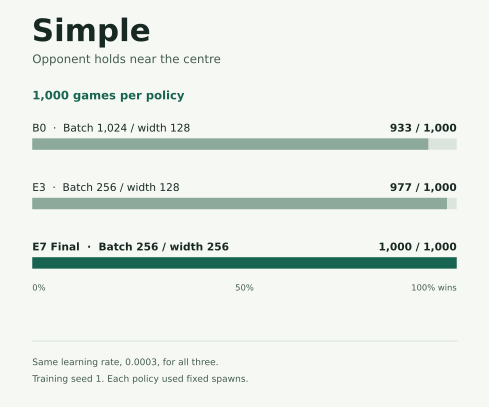
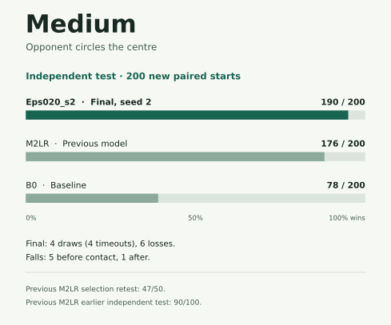
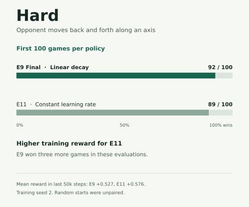
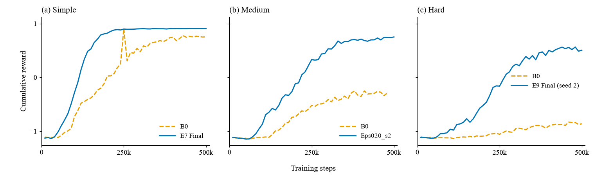

# PPO policy evaluation in Unity

Team 3 trained a rolling agent with proximal policy optimization (PPO). The red agent tries to push a rule-based opponent off a platform while staying on it. Simple holds near the centre, Medium circles the centre, and Hard moves back and forth along an axis.

| Environment | Selected policy | Evaluation |
| --- | --- | --- |
| Simple | E7, seed 1 | 1,000 wins in 1,000 games on fixed starts |
| Medium | Eps020_s2, seed 2 | **190 wins, 4 draws and 6 losses on 200 independent paired starts** |
| Hard | E9, seed 2 | 92 wins, 5 draws and 3 losses in the first 100 unpaired games |

Each number applies to its own evaluation protocol. In Medium, the previous M2LR model won 47/50 in its selection retest and 90/100 in an earlier independent test. In the new independent test on starts 650000–650199, Eps020_s2 won 190/200, previous M2LR won 176/200, and B0 won 78/200. Eps020_s2 recorded 5 falls before contact, 1 after contact, and 4 timeouts, included in the draw count. Hard's seed 2 export was selected after comparison. The submission has one to two training seeds for the configurations discussed here.

## Evaluation and training

| Simple | Medium | Hard |
| --- | --- | --- |
|  |  |  |



In Medium's paired checkpoint comparison, the previous M2LR export won 92/100. The earlier selection retest and independent holdout used separate sets of starts.

## Reproduce the charts

```sh
python -m pip install -r requirements.txt
python analysis/plot_results.py --output figures --training
```

The plot script reads the CSVs in `data/`. Each figure is exported as SVG and PNG. The optional training figure compares the final policy with B0 for each difficulty. It uses the presentation's chart data and the Eps020_s2 TensorBoard log, with one run per line. Medium B0's last recorded point is 480,000.

- [`evaluation_summary.csv`](data/evaluation_summary.csv) records the aggregate evaluation counts and their source rows and slides. For Simple and Hard, these are the submitted aggregate counts.
- [`medium_rounds.csv`](data/medium_rounds.csv) contains the 150 screening games and 100 retest games. Each phase used the same set of starting seeds across policies. A timeout is already part of the draw count. The supplementary recording rounds are outside this dataset.
- New independent evaluation: [`medium_independent_200.csv`](data/medium_independent_200.csv) contains 200 episodes each for Eps020_s2, previous M2LR and B0. The matching [summary](data/medium_independent_200_summary.csv) and [protocol](data/medium_independent_200_protocol.json) list the falls, timeouts, model hashes and seeds.
- Historical independent evaluation: [`medium_holdout_100.csv`](data/medium_holdout_100.csv) records the earlier 100 M2LR games.
- Epsilon screening: [`medium_epsilon_screening.csv`](data/medium_epsilon_screening.csv) records the four training runs. Seed 2 at epsilon 0.20 won 96/100 in screening. Across seeds 2 and 3, epsilon 0.20 won 183/200 and epsilon 0.15 won 168/200.
- [`training_rewards.csv`](data/training_rewards.csv) contains the selected training curves. The training values are logged cumulative rewards. Hard's reported last-50k averages are recorded separately in the evaluation summary.

## Load the final ONNX policies

[Simple ONNX](models/Simple_Final.onnx) · [Medium ONNX](models/Medium_Final.onnx) · [Hard ONNX](models/Hard_Final.onnx)

The evaluation project used Unity **2022.3.39f1** and the Unity package **com.unity.ml-agents 2.0.2**. Use the matching Assignment 2 Unity project to reproduce the game environment.

1. Copy the corresponding `models/<Mode>_Final.onnx` into that Unity project's `Assets/` folder.
2. Open the matching Simple, Medium or Hard scene and select the learning agent.
3. Assign the imported model in Behavior Parameters, set Behavior Type to **Inference Only**, choose **CPU**, and enter Play mode. The agent interface has 12 vector observations and two discrete action branches with three choices each.
4. Check [`model_cards.json`](models/model_cards.json) and [`SHA256SUMS`](models/SHA256SUMS) for identity, seed, documented settings and artifact hashes.

`configs/medium/` contains the five original Medium configurations and the Eps020_s2 trainer configuration. Simple and Hard settings are documented in the model cards. The submission material includes no complete runnable trainer YAML for those two modes.

[`MediumFinalEvaluation.cs`](unity/Runtime/MediumFinalEvaluation.cs) is the evaluation component used to record outcomes with paired starting positions. It depends on the original course `RollerGameController` and matching Medium scene. The directory is a source reference and requires the course project.

[Project page](https://yuxuanweng.com/project.html?slug=ppo)

